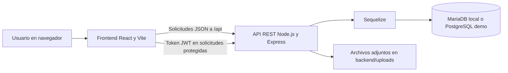
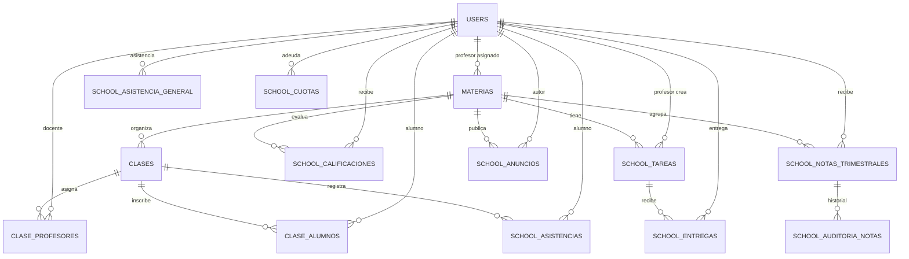

# SISTEMA DE GESTIÓN

## COLEGIO REINA DE LA ESPERANZA

**Documentación técnica y manual de usuario**

| Dato | Información |
|---|---|
| Institución | Colegio Reina de la Esperanza |
| Nombre del sistema | Gestión Escolar Reina de la Esperanza |
| Tipo de solución | Aplicación web con frontend y API REST |
| Integrantes y roles | [Completar] |
| Asignatura / docente | [Completar si corresponde] |
| Versión / fecha de entrega | [Completar] |
| URL de demostración | [Completar si corresponde] |

> Completar los campos entre corchetes antes de entregar. La documentación describe el código y la configuración actualmente presentes en el proyecto. Las capturas reales deben agregarse en `docs/capturas/`; no se deben usar datos personales del alumnado.

## Índice

1. [Introducción y descripción general](#1-introducción-y-descripción-general)
   1. [Introducción](#11-introducción)
   2. [Objetivos a cumplir](#12-objetivos-a-cumplir)
2. [Diagramas](#2-diagramas)
   1. [Infraestructura](#21-infraestructura)
   2. [Entidad-relación](#22-entidad-relación)
3. [Manual técnico](#3-manual-técnico)
   1. [Preparación del proyecto](#31-preparación-del-proyecto)
   2. [Front-end](#32-front-end)
   3. [Back-end](#33-back-end)
   4. [Despliegue y pruebas](#34-despliegue-y-pruebas)
4. [Manual de usuario](#4-manual-de-usuario)
   1. [Acceso al sistema](#41-acceso-al-sistema)
   2. [Vista del rol administrativo](#42-vista-del-rol-administrativo)
   3. [Vista del rol profesor](#43-vista-del-rol-profesor)
   4. [Vista del rol alumno](#44-vista-del-rol-alumno)
   5. [Gestión de materias y horarios](#45-gestión-de-materias-y-horarios)
   6. [Sistema de tareas y calificaciones](#46-sistema-de-tareas-y-calificaciones)
   7. [Control de asistencia](#47-control-de-asistencia)
   8. [Sistema de comunicados](#48-sistema-de-comunicados)
5. [Conclusión](#5-conclusión)
6. [Anexo: capturas y lista de entrega](#6-anexo-capturas-y-lista-de-entrega)

## 1. Introducción y descripción general

### 1.1 Introducción

**Gestión Escolar Reina de la Esperanza** es una aplicación web para apoyar la gestión académica y administrativa del Colegio Reina de la Esperanza. Reúne en una misma plataforma herramientas para el personal administrativo, los docentes y los alumnos, con acceso y pantallas diferenciadas por rol.

El sistema cuenta con una presentación institucional pública y módulos privados para tareas escolares como la gestión de usuarios, materias y clases, el seguimiento de tareas y entregas, la consulta de calificaciones, la asistencia y la publicación de anuncios.

La solución se compone de una interfaz web construida con React y una API REST construida con Express. Los datos se almacenan en una base relacional: MariaDB se utiliza como configuración predeterminada para el desarrollo local y PostgreSQL está habilitado para el despliegue de demostración.

**Usuarios del sistema**

| Usuario | Uso principal |
|---|---|
| Administrativo | Administra usuarios, materias, clases y procesos académicos habilitados para su rol. |
| Profesor | Consulta clases y alumnos, publica tareas y anuncios, y trabaja con entregas, notas y asistencia. |
| Alumno | Consulta información académica, tareas, asistencia, boletín y anuncios; puede entregar trabajos. |

### 1.2 Objetivos a cumplir

- **Modernizar la gestión académica:** digitalizar procesos escolares y facilitar el acceso a la información.
- **Mejorar la interacción:** ofrecer herramientas diferenciadas para alumnos, docentes y personal administrativo.
- **Centralizar la administración:** gestionar cuentas, materias, clases y asignaciones desde la plataforma.
- **Acompañar el seguimiento académico:** facilitar el trabajo con tareas, entregas, calificaciones y asistencia.
- **Fortalecer la presencia institucional:** presentar al colegio y su propuesta educativa mediante una página pública.
- **Simplificar procesos escolares:** apoyar el registro de asistencia y la publicación de anuncios desde los módulos correspondientes.

## 2. Diagramas

### 2.1 Infraestructura

El navegador carga la aplicación frontend. Esta se comunica por HTTP/HTTPS con la API, que valida la sesión, ejecuta la lógica del servidor y accede a la base de datos. Los archivos adjuntos se sirven desde el backend.



**Componentes**

| Componente | Responsabilidad |
|---|---|
| Frontend | Presenta las páginas institucionales y los paneles según el rol. |
| API REST | Expone operaciones bajo `/api`, valida solicitudes y aplica la lógica del servidor. |
| Sequelize | Capa de acceso relacional utilizada por el backend. |
| MariaDB / PostgreSQL | Persisten usuarios y registros escolares, según el entorno configurado. |
| Directorio `uploads` | Conserva los archivos adjuntos del backend; en el plan gratuito de Render el disco puede ser efímero. |

### 2.2 Entidad-relación

El siguiente diagrama es **conceptual**: resume algunas entidades y asociaciones principales del esquema SQL. Para documentación académica definitiva, generar además un diagrama físico del esquema migrado desde DBeaver, MySQL Workbench u otra herramienta, y reemplazar o complementar este esquema con una captura legible.



| Tabla o grupo | Propósito |
|---|---|
| `users` | Cuentas, rol y datos escolares del usuario. |
| `materias`, `clases` | Materias, curso, división y horario. |
| `clase_profesores`, `clase_alumnos` | Asignaciones de docentes y alumnos a clases. |
| `school_tareas`, `school_entregas` | Tareas y entregas de los alumnos. |
| `school_asistencias`, `school_asistencia_general` | Asistencia asociada a clases y registro general. |
| `school_calificaciones`, `school_notas_trimestrales` | Calificaciones y notas por trimestre. |
| `school_auditoria_notas` | Historial de modificaciones de notas. |
| `school_anuncios` | Comunicados asociados a materias y docentes. |
| `school_cuotas` | Cuotas asociadas a usuarios. |

El esquema vigente se crea desde `proyectocolegio-backend/src/database/migrations/`. Los archivos de MongoDB que puedan existir en `proyectocolegio-backend/data/db` son datos heredados; no constituyen la base activa de las instrucciones SQL actuales.

## 3. Manual técnico

### 3.1 Preparación del proyecto

#### 3.1.1 Cómo empezar

**Requisitos:** Node.js, npm, Git y una instancia MariaDB para el entorno local. PostgreSQL se usa en la configuración de despliegue de demostración.

El repositorio tiene dos aplicaciones independientes:

```text
proyectoColegio-frontend/   Interfaz web React/Vite
proyectocolegio-backend/    API Express, migraciones y acceso a datos
docs/                       Documentación y capturas de entrega
```

Clonar el repositorio desde la dirección proporcionada por el equipo y abrir dos terminales en la carpeta del proyecto. No versionar archivos `.env`, respaldos, contraseñas, tokens ni datos reales.

#### 3.1.2 Instalar las dependencias

Desde PowerShell, instalar las dependencias de cada aplicación:

```powershell
cd proyectocolegio-backend
npm install
```

En otra terminal, desde la carpeta raíz:

```powershell
cd proyectoColegio-frontend
npm install
```

Los comandos de desarrollo son `npm run dev` tanto en el backend como en el frontend. Ejecutarlos en terminales separadas.

#### 3.1.3 Configurar la base de datos

**Desarrollo local con MariaDB**

1. Instalar/iniciar MariaDB y preparar credenciales locales.
2. En la terminal del backend, crear la base de datos y aplicar las migraciones académicas:

   ```powershell
   npm run db:create:local
   npm run migrate:academics
   ```

3. Para datos de práctica ficticios, ejecutar opcionalmente:

   ```powershell
   npm run seed:local
   npm run seed:academics
   ```

Las migraciones deben ejecutarse antes de iniciar el servidor en una base nueva. Los seeders son para desarrollo/demo; no se deben ejecutar contra una base productiva sin revisar su efecto.

**Demostración con PostgreSQL**

El despliegue de Render configura `DB_DIALECT=postgres` y conecta una base separada mediante `DATABASE_URL`. El seed demo está restringido a PostgreSQL y requiere activación explícita y contraseñas de demo. No usar información ni credenciales reales del colegio. Consultar `DEMO-DEPLOYMENT.md` para el procedimiento y las limitaciones del alojamiento.

> El proyecto actual no usa MongoDB como base operativa de estos módulos ni describe MySQL como integración futura: la configuración SQL implementada admite MariaDB y PostgreSQL.

#### 3.1.4 Configurar las variables de entorno

Crear `proyectocolegio-backend/.env` localmente y completar valores propios. Ejemplo de desarrollo:

```dotenv
NODE_ENV=development
DB_DIALECT=mariadb
DB_HOST=127.0.0.1
DB_PORT=3306
DB_NAME=colegio
DB_USER=root
DB_PASSWORD=CAMBIAR_POR_LA_CLAVE_LOCAL
JWT_SECRET=CAMBIAR_POR_UN_SECRETO_LARGO_ALEATORIO
FRONTEND_URL=http://localhost:5173
PORT=5000
```

`DB_PASSWORD` también puede proporcionarse como `DB_PASS`. La conexión de PostgreSQL requiere `DB_DIALECT=postgres` y `DATABASE_URL`.

El frontend acepta `VITE_API_URL`; localmente usa por defecto `http://localhost:5000`. Para cambiarlo, definirlo en el entorno de Vite antes de iniciar la aplicación. Las variables de frontend con prefijo `VITE_` se incorporan al cliente; no guardar secretos en ellas.

En Render, los valores de producción se configuran en el panel del servicio/Blueprint, no en archivos versionados. La demo utiliza además `DEMO_ADMIN_EMAIL`, `DEMO_ADMIN_PASSWORD`, `DEMO_USER_PASSWORD` y `DEMO_SEED_ENABLED`. No copiar credenciales reales a este documento.

### 3.2 Front-end

#### 3.2.1 Tecnologías usadas

- **React:** construcción de la interfaz y componentes.
- **Vite:** servidor de desarrollo y empaquetado de producción.
- **React Router:** navegación entre páginas y paneles.
- **Axios:** solicitudes HTTP a la API REST.
- **Tailwind CSS:** utilidades de estilo.
- **Framer Motion:** animaciones de interfaz.
- **Context API:** estado compartido de autenticación.
- **JWT y almacenamiento del navegador:** el cliente adjunta el token a solicitudes autenticadas.

#### 3.2.2 Implementación del código

El frontend está en `proyectoColegio-frontend/src/`. `App.jsx` configura las rutas; `AuthContext` mantiene el estado de autenticación; `PrivateRoute` restringe páginas a usuarios autenticados y, cuando se especifica, a roles permitidos.

| Carpeta / archivo | Responsabilidad |
|---|---|
| `src/pages/` | Páginas y paneles de administración, docente y alumno. |
| `src/components/` | Componentes reutilizables, navegación, acceso y formularios. |
| `src/sections/` | Secciones de la página institucional pública. |
| `src/context/AuthContext.jsx` | Contexto de sesión y usuario. |
| `src/api/api.js` | Cliente Axios, URL del backend y funciones de acceso a endpoints. |

La interfaz no sustituye la autorización del servidor: las operaciones protegidas deben comprobarse en la API y no solo ocultarse visualmente en el cliente.

Comandos habituales:

```powershell
npm run dev
npm run lint
npm run build
```

### 3.3 Back-end

#### 3.3.1 Tecnologías usadas

- **Node.js:** ejecución de JavaScript en el servidor.
- **Express:** API REST y montaje de rutas.
- **Sequelize:** acceso relacional y conexión MariaDB/PostgreSQL.
- **MariaDB / PostgreSQL:** almacenamiento de datos según el entorno.
- **JWT:** autenticación de solicitudes.
- **bcryptjs:** hash de contraseñas.
- **express-validator:** validación de campos en rutas que la implementan.
- **CORS, Helmet y Morgan:** configuración de solicitudes entre orígenes, cabeceras HTTP y registro de solicitudes.
- **Multer:** recepción de archivos.

#### 3.3.2 Implementación del código

El backend está en `proyectocolegio-backend/src/`. Sigue una separación por rutas, controladores, middlewares, modelos/configuración y migraciones:

| Carpeta / archivo | Responsabilidad |
|---|---|
| `src/index.js` | Configura Express, middleware, rutas `/api` y el inicio del servidor. |
| `src/routes/` | Declara endpoints y middleware de acceso/validación. |
| `src/controllers/` | Implementa operaciones solicitadas por las rutas. |
| `src/middlewares/` | Autenticación, permisos y validaciones compartidas. |
| `src/models/` | Modelos de datos y asociaciones usadas por el backend. |
| `src/config/mariadb.js` | Selección del dialecto y conexión Sequelize. |
| `src/database/migrations/` | Esquema relacional versionado. |
| `uploads/` | Archivos adjuntos publicados desde `/uploads`. |

Los principales prefijos de API son `/api/auth`, `/api/usuarios`, `/api/materias`, `/api/clases`, `/api/tareas`, `/api/entregas`, `/api/calificaciones`, `/api/notas`, `/api/asistencias`, `/api/anuncios`, `/api/cuotas` y `/api/admin`. La ruta `/` comprueba que la API inició y muestra el dialecto conectado.

Comandos habituales:

```powershell
npm run dev
npm test
npm run test:postgres-compat
```

#### 3.3.3 Configuración de correo y archivos

La interfaz incluye solicitud y restablecimiento de contraseña. El envío real de enlaces por correo depende de una configuración SMTP del entorno; verificarla antes de presentar la recuperación como operativa.

Los adjuntos se guardan en el directorio `uploads` del backend y se acceden mediante `/uploads`. El plan gratuito de Render puede usar almacenamiento efímero, por lo que esos archivos no deben considerarse persistentes allí.

### 3.4 Despliegue y pruebas

El despliegue de demostración está definido en `render.yaml`: frontend estático y backend web con PostgreSQL. Seguir `DEMO-DEPLOYMENT.md`; usar únicamente usuarios y datos ficticios. En la demo compartida, otros visitantes pueden modificar los registros.

Antes de entregar, ejecutar y anotar los resultados reales:

```powershell
# En proyectocolegio-backend
npm test
npm run test:postgres-compat

# En proyectoColegio-frontend
npm run lint
npm run build
```

| Verificación | Resultado / fecha |
|---|---|
| Pruebas backend (`npm test`) | [Completar al ejecutar] |
| Compatibilidad PostgreSQL | [Completar al ejecutar] |
| Lint frontend | [Completar al ejecutar] |
| Compilación frontend | [Completar al ejecutar] |

## 4. Manual de usuario

### 4.1 Acceso al sistema

1. Abrir la URL de la aplicación web proporcionada por la institución.
2. Seleccionar el acceso e ingresar el correo y la contraseña asignados.
3. Si las credenciales son válidas, el sistema dirige al usuario al panel de su rol: administración, profesor o alumno.
4. Si no puede iniciar sesión, comprobar los datos con el responsable del sistema. El flujo de recuperación permite solicitar un restablecimiento cuando el correo está configurado.

No se incluyen credenciales en este documento. Las cuentas de seed son para pruebas locales; las cuentas públicas de demo, si se comparten, deben ser las configuradas para ese entorno y no las credenciales personales.

### 4.2 Vista del rol administrativo

El panel administrativo incluye accesos a funciones como:

- Resumen del panel administrativo.
- Consulta y gestión de usuarios.
- Gestión de materias y clases.
- Asignación de alumnos a clases.
- Registro/consulta de asistencias.
- Gestión, revisión y auditoría de notas.

La disponibilidad exacta depende de los permisos asignados y de la versión desplegada. Verificar cada flujo con una cuenta administrativa de prueba antes de describirlo como parte de la entrega.

**Capturas sugeridas:** panel y menú administrativo; lista de usuarios ficticios; pantalla de materias/clases; pantalla de notas o auditoría sin datos reales.

### 4.3 Vista del rol profesor

El panel docente dispone de páginas para consultar clases, alumnos y tareas, cargar tareas, revisar entregas, gestionar anuncios, tomar asistencia y trabajar con las notas de sus materias.

**Capturas sugeridas:** inicio del profesor con datos ficticios; una clase; formulario de tarea; revisión de entrega; pantalla de asistencia o carga de notas.

### 4.4 Vista del rol alumno

El panel del alumno ofrece accesos a inicio, materias, inscripción/consulta de clases, tareas, asistencia, boletín y anuncios. Desde los flujos correspondientes puede consultar actividades y enviar una entrega.

**Capturas sugeridas:** panel del alumno demo; lista de materias o tareas; boletín y asistencia de un usuario ficticio; pantalla de entrega sin archivos personales.

### 4.5 Gestión de materias y horarios

El sistema organiza materias y clases con datos como año, división, día, hora y aula. El personal autorizado administra las materias y clases, y gestiona las asignaciones de docentes y alumnos disponibles en el sistema.

Para documentar el proceso, mostrar una materia y un horario ficticios. Evitar exponer listados reales de estudiantes.

### 4.6 Sistema de tareas y calificaciones

El flujo general de tareas es:

1. El profesor publica una tarea para la materia, con título, descripción y vencimiento.
2. El alumno consulta sus tareas y prepara la entrega según las instrucciones.
3. El alumno envía su trabajo mediante el módulo de entregas.
4. El profesor revisa la entrega y utiliza las funciones académicas habilitadas para registrar la evaluación o devolución.

Las notas incluyen calificaciones y notas trimestrales; hay una tabla de auditoría para cambios relacionados con notas. El detalle de los campos y las aprobaciones depende de la vista y permisos configurados. Utilizar datos ficticios en capturas.

### 4.7 Control de asistencia

Los usuarios autorizados pueden registrar asistencia de alumnos asociada a una clase y fecha. El sistema contempla estados como presente, ausente, tarde y justificado en las tablas de asistencia. El alumno puede consultar su asistencia desde su panel.

No afirmar que existen alertas automáticas o reportes no verificados en la versión desplegada. Para la evidencia, registrar una prueba con alumnos ficticios y fecha de demostración.

### 4.8 Sistema de comunicados

El módulo de anuncios permite al profesor publicar comunicados asociados a materias; los alumnos cuentan con una página para consultar anuncios. Revisar la audiencia que aplica al anuncio en la implementación desplegada antes de describirlo como institucional o personalizado.

Capturar un anuncio de ejemplo sin datos privados ni información sensible.

## 5. Conclusión

Gestión Escolar Reina de la Esperanza integra una experiencia web institucional con herramientas académicas diferenciadas para administración, docentes y alumnos. La separación entre frontend, API y persistencia relacional brinda una base organizada para el mantenimiento y la evolución del sistema.

La plataforma digitaliza flujos como la gestión de usuarios, materias, clases, tareas, entregas, notas, asistencias y anuncios. Su uso debe acompañarse de una configuración segura de credenciales, copias de respaldo y protección de la información escolar. La demostración debe realizarse con datos ficticios y las funciones externas, como el envío de correos, deben configurarse y comprobarse en el entorno donde se presenten.

## 6. Anexo: capturas y lista de entrega

### 6.1 Capturas recomendadas

Guardar las imágenes en `docs/capturas/` y, si se agregan al documento, insertarlas usando enlaces relativos. Las capturas siguientes son una guía; deben tomarse de la aplicación real, no inventarse.

| ID | Evidencia | Nombre sugerido |
|---|---|---|
| E01 | Página institucional de inicio | `01-inicio.png` |
| E02 | Acceso (sin mostrar correo/contraseña) | `02-acceso.png` |
| E03 | Panel administrativo | `03-panel-admin.png` |
| E04 | Gestión de usuarios ficticios | `04-usuarios.png` |
| E05 | Materias, clases y horarios de prueba | `05-materias-clases.png` |
| E06 | Panel del profesor | `06-panel-profesor.png` |
| E07 | Tarea o entrega ficticia | `07-tareas-entregas.png` |
| E08 | Notas y auditoría con datos de ejemplo | `08-notas-auditoria.png` |
| E09 | Asistencia de prueba | `09-asistencia.png` |
| E10 | Panel y consulta del alumno demo | `10-panel-alumno.png` |
| E11 | Diagrama físico de la base de datos | `11-esquema-bd.png` |
| E12 | Tablas/columnas de la base (sin datos identificables) | `12-tablas-bd.png` |
| E13 | Resultados reales de pruebas ejecutadas | `13-pruebas.png` |
| E14 | Sitio demo y URL, si está desplegado | `14-demo.png` |

Para capturar la base de datos, conectar DBeaver o MySQL Workbench a un entorno de desarrollo, generar el diagrama ER desde el esquema migrado y encuadrar tablas y relaciones para que se lean. Si se muestran registros, usar únicamente datos ficticios. Ocultar contraseñas, tokens, DNIs, datos de contacto, URLs privadas y credenciales de conexión.

### 6.2 Lista final

- [ ] Completar integrantes, roles, asignatura, docente, versión y fecha.
- [ ] Confirmar que el nombre institucional sea el oficial en portada y capturas.
- [ ] Generar y adjuntar el diagrama físico actualizado desde la base migrada.
- [ ] Incorporar las capturas reales que correspondan y quitar evidencias no aplicables.
- [ ] Usar datos ficticios o anonimizar información en todas las imágenes.
- [ ] Ejecutar las pruebas y reemplazar los resultados pendientes por resultados reales.
- [ ] Revisar la configuración SMTP si se va a demostrar recuperación por correo.
- [ ] Verificar URL y limitaciones del despliegue si se presenta una demo.
- [ ] Confirmar que no se adjunten `.env`, claves, tokens ni datos personales.

